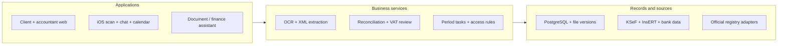
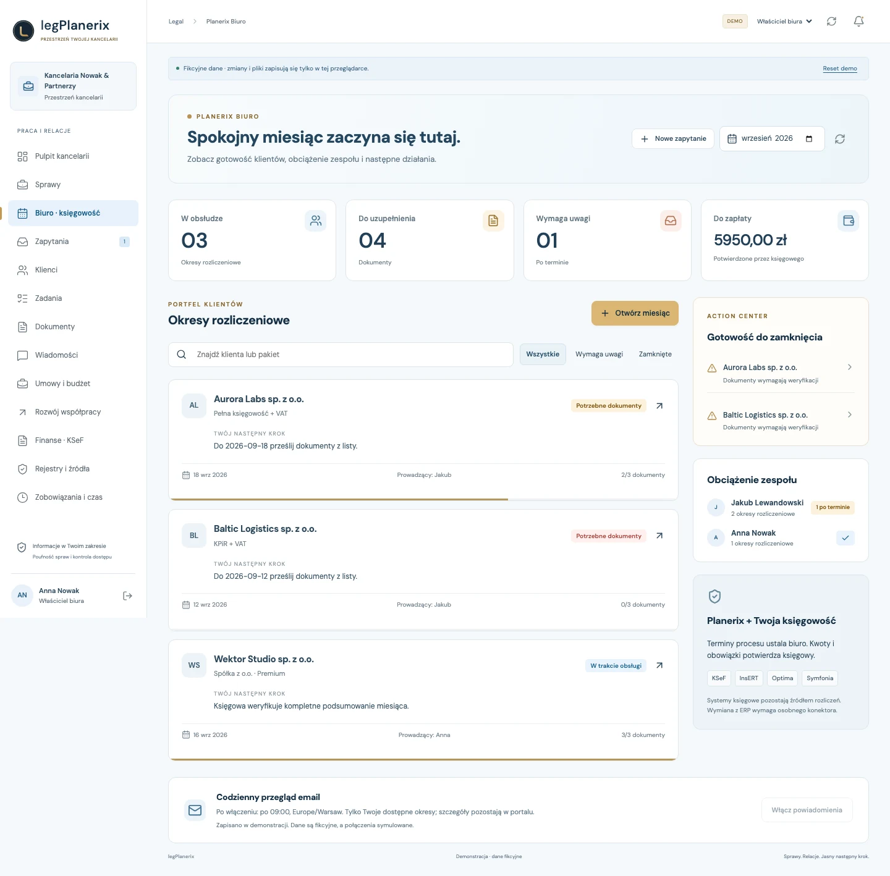

# LEG / Planerix Biuro

**Document Intelligence & Connected Accounting**

Connect documents with company finance.

[Portfolio index](../README.md) · [All case studies](README.md)

## Problem

Documents, payments and accounting follow-up often arrive through different channels.

## Engineering challenge

Connect mobile document capture, company finance and accounting work without losing source identity, calculation precision or client-specific access.

## Architecture

A simplified view of the implemented system; deployment and provider activation vary by product.

## Implementation

Connected mobile scanning, invoice parsing, financial analysis, official-source adapters, chat and period-based accounting work.

- **Capture documents.** Scan from iPhone, upload files and parse invoice data from supported OCR / XML paths. Original documents remain available for review.
- **Connect financial records.** Bring invoice sources, payment evidence and reconciliation into one place. KSeF and InsERT adapters support configured document workflows.
- **Prepare the period.** Financial and tax calculations, missing-document status, calendar dates and reminders support month-end preparation and accountant review.
- **Work with evidence.** Company-scoped chat and agents help inspect documents and financial context. Owners can follow up from web or native iOS.

### Engineering decisions

- Capture preserves the original version; extracted text, invoice fields and provenance are derived data. OCR or a provider import does not silently certify a financial record.
- Decimal calculations and explicit allocations keep document totals, provider payment evidence and bank cash distinct. Currency, company and period boundaries remain visible.
- Company-finance grants and independent document checks constrain chat and AI. Answers retain source references; changed access or evidence blocks a stale response.

### Technology and its purpose

| Technology | Responsibility |
|---|---|
| SwiftUI / VisionKit | Native scan and PDF capture |
| FastAPI | Parsing, review and company APIs |
| PostgreSQL | Versions, records and period state |
| Next.js | Client and accountant web |

Connected systems: KSeF — invoice sync and downloads; InsERT / Subiekt 123 — read-only invoice snapshots; Stripe — payment evidence.

## Evidence

Actual LEG demo interfaces, source-inspected iOS capture and accounting services, plus 40 executed fixture tests for reconciliation, financial analysis, KSeF parsing and calendar logic.

LEG company workspace. Demonstration company and financial records.

## Outcome and ownership

A company workspace connects document capture, invoice parsing, reconciled finance, reporting tasks, chat, calendar and source-based AI across web and iOS.

**My role:** Founder & product architect.

- **Architecture ownership:** Founder and product architect: business model, system design, web/native work model and product boundaries.
- **Product development:** Document capture and parsing, company finance, registry connections, accounting workflows and source-based AI across web and native iOS.
- **Product leadership:** Product scope and integration decisions across the ecosystem.

### Scope and boundaries

Provider access requires configuration. VAT workpapers and reporting controls support accountant review; automatic filing, government acceptance and tax correctness certification are not claimed. Demo figures are fictional.

### Explore

- [Project case](https://proleev.com/en/products/biuro)
- [Public product](https://leg.planerix.com)

[Selected verification and evidence policy](../engineering/evidence.md)
