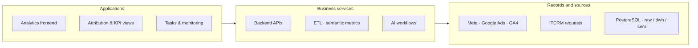

# IT STEP Academy

**Attribution, Data Platforms & AI**

Give management a shared analytical foundation.

[Portfolio index](../README.md) · [All case studies](README.md)

## Problem

Marketing, CRM and business data need common definitions before attribution and AI can be useful.

## Engineering challenge

Connect advertising spend, website activity and CRM requests into a consistent attribution and performance-monitoring system.

## Architecture

A simplified view of the implemented system; deployment and provider activation vary by product.

## Implementation

Led data and ETL/API architecture, attribution, KPI and semantic layers, frontend/backend, monitoring and AI-assisted workflows.

- **Collect source data.** n8n and API workflows ingest Google Ads, Meta Ads, GA4 and CRM records. Archived exports document the source and transformation paths.
- **Make reporting comparable.** PostgreSQL raw, warehouse and semantic layers separate source records, transformations and agreed KPI definitions.
- **Review business performance.** Attribution, reporting interfaces and metric monitoring connect acquisition activity to available CRM and business context.
- **Support ongoing execution.** Frontend/backend services, tasks and AI-assisted workflows help teams inspect metrics and coordinate follow-up from a shared data environment.

### Engineering decisions

- Separate ingestion, warehouse and semantic layers align advertising, traffic and CRM records before they reach executive dashboards.
- Application identity and tasks resolve from Core; IT STEP analytics resolves from its analytics database. Backend guards and workspace-aware navigation enforce this boundary.
- Attribution views, metric monitoring and AI-agent workflows connect data preparation with analysis and follow-up work. Source freshness remains visible as a separate operational concern.

### Technology and its purpose

| Technology | Responsibility |
|---|---|
| PostgreSQL | Raw, warehouse and semantic layers |
| FastAPI | Analytics and workspace APIs |
| Next.js | Attribution and KPI interface |
| n8n | Data and AI workflows |

Connected systems: Meta — advertising insights; Google Ads — campaign performance; Google Analytics 4 — website activity; ITCRM — client request records.

## Evidence

Archived n8n workflow and SQL exports document ingestion, transformation and metric definitions. The public diagrams explain this lineage across Meta, Google Ads, GA4, ITCRM and PostgreSQL without exposing client rows or credentials.

## Outcome and ownership

Delivered the data and application layers for end-to-end analytics: source ingestion, databases, attribution, frontend/backend, monitoring and AI-agent workflows.

**My role:** Engineering project lead / Feb 2025 - Feb 2026.

- **Personally designed:** Translated management requirements into the data, analytics and automation architecture. Contract: February 2025 - February 2026.
- **Led implementation:** ETL/API architecture, attribution, databases, KPI and semantic layers, frontend/backend, monitoring and AI-assisted workflows.
- **Led & coordinated:** Connected business, marketing, finance and technology requirements; guided implementation and operational use.

### Scope and boundaries

Personal responsibility is engineering project leadership across the listed data and application layers. The architecture evidence is historical; current tenant uptime, attribution accuracy and ROI are not claimed.

Some internal data and implementation details are protected by NDA. Public examples identify demonstration or prototype interfaces.

### Explore

- [Project case](https://proleev.com/en/case-studies/itstep)

[Selected verification and evidence policy](../engineering/evidence.md)
