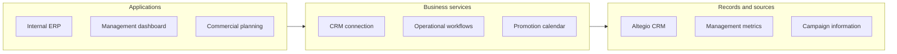
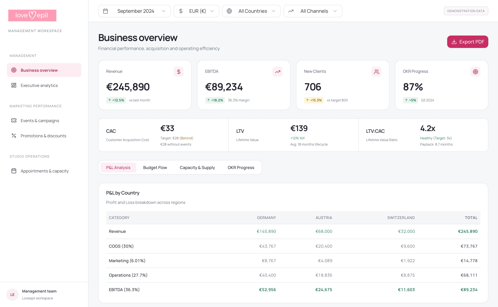

# Loveepil

**Internal ERP, CRM integration and marketing operations**

Turn CRM activity into management visibility.

[Portfolio index](../README.md) · [All case studies](README.md)

## Problem

Customer records, promotion plans and reporting need to support the same operating process.

## Engineering challenge

Connect internal business workflows, Altegio CRM, management dashboards and marketing processes in a delivered operating system.

## Architecture

A simplified view of the implemented system; deployment and provider activation vary by product.

## Implementation

Developed an internal ERP with Altegio CRM integration and management dashboards, alongside marketing strategy and promotion planning.

- **Internal ERP.** Business workflows and operational structure.
- **CRM integration.** Connection to Altegio customer and commercial context.
- **Management dashboards.** Reporting that supports management review.
- **Marketing operations.** Strategy, promotion calendar and commercial processes.

### Engineering decisions

- Developed an internal ERP with an Altegio CRM connection, aligning the operating workflow with customer and commercial context.
- Created management dashboards and marketing processes covering strategy, promotion planning and reporting.
- Delivered and handed over the project to the client. NDA-protected internals are described through the shareable delivery scope without exposing customer data.

### Technology and its purpose

| Technology | Responsibility |
|---|---|
| Next.js | Retained management interface |
| React | Dashboard and reporting components |
| TypeScript | Typed frontend implementation |

Connected systems: Altegio CRM — connected customer and commercial context.

## Evidence

The retained management interface illustrates the delivered ERP and reporting workflow. Styling has been refined for the portfolio and the displayed figures are demonstration data. Altegio integration and private backend details are described at the shareable scope level.

Retained Loveepil interface, visually refined with demonstration data. Private ERP and CRM records remain under NDA.

## Outcome and ownership

Delivered an internal ERP, Altegio CRM integration, management dashboards and marketing operating processes; handed over to the client.

**My role:** ERP developer & marketing operations lead.

- **Personally designed:** Internal operating workflows, ERP structure and the connection between CRM, marketing planning and reporting.
- **Personally implemented:** Internal ERP with Altegio CRM integration and management dashboards.
- **Strategy & handover:** Marketing strategy, commercial processes and promotion calendar. The project was handed over to the client.

### Scope and boundaries

Project handed over to the client. Internal implementation data and results are protected by NDA.

### Explore

- [Project case](https://proleev.com/en/case-studies/loveepil)

[Selected verification and evidence policy](../engineering/evidence.md)
