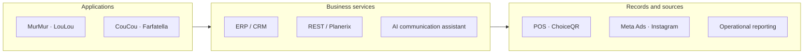
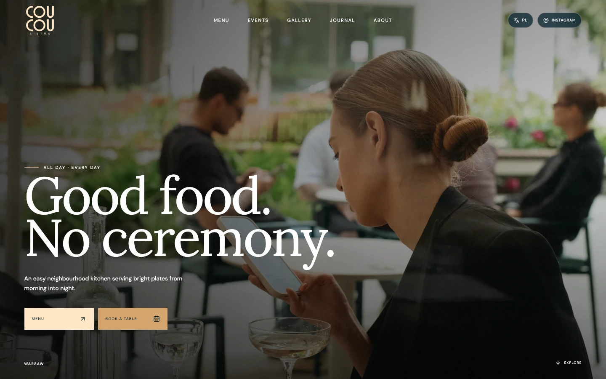

# Ninja Group

**ERP/CRM & Data Integration**

Connect restaurant brands with shared operations.

[Portfolio index](../README.md) · [All case studies](README.md)

## Problem

Distinct restaurant brands need their own customer journeys and a common operating picture.

## Engineering challenge

Connect distinct restaurant brands with shared operating processes, source data and customer communications.

## Architecture

Brand websites connect with the customer, operating and reporting layers described below.

## Implementation

Developed websites, internal ERP/CRM, an application, dashboards, advertising setup and end-to-end analytics; led marketing strategy.

- **Brand websites.** Individual restaurant experiences retain their own identity, content and guest journey.
- **Guest entry points.** Public restaurant pages connect menu and booking entry points with the brand experience.
- **Shared ERP and CRM.** Common operating context supports coordinated work across the group.
- **Communications and AI.** Instagram intake, conversation classification, manager assistance and manual handoff.

### Engineering decisions

- Brand websites keep their own identity; project and restaurant context organize the shared management workspace.
- Sales and marketing sources feed reporting. Instagram Direct, the AI communication assistant and CRM connect the conversation to its context.

### Stack

| Technology | Responsibility |
|---|---|
| FastAPI | Shared API and integration rules |
| PostgreSQL | Shared operational records |
| Next.js / React | Separate restaurant websites |
| TypeScript | Web application contracts |
| Planerix REST | Connected mobile platform |
| Planerix | Workspace and analytical context |

Connected systems: Meta / Instagram — marketing and direct communication; ChoiceQR — restaurant menu and booking sources.

## Evidence

The public CouCou capture shows the customer-facing work. The architecture describes the ERP/CRM, connector and reporting scope; internal client screens and messages are omitted under NDA.

Public CouCou website. Private ERP and CRM records are not shown.

## Outcome and ownership

Restaurant websites, ERP/CRM, marketing data and mobile workflows through REST/Planerix. Instagram Direct connects communications with the CRM.

**My role:** Systems architect & developer.

- **Personally designed:** The connected website, CRM, application, dashboard and marketing analytics solution.
- **Personally implemented:** Websites, internal CRM, application, dashboards, advertising account setup and end-to-end analytics.
- **Strategy & delivery:** Marketing strategy and connection of commercial activity with operational and analytical workflows.

### Delivery notes

Personal scope is systems architecture and delivery across the listed workstreams. Brand operations and third-party products are not presented as solely authored software; commercial uplift is not quantified.

Some internal data and implementation details are protected by NDA. Public examples identify demonstration or prototype interfaces.

### Links

- [Project case](https://proleev.com/en/case-studies/ninja-group)
- [Delivered website / CouCou](https://coucoubistro.com)

[Verification notes](../engineering/evidence.md)
