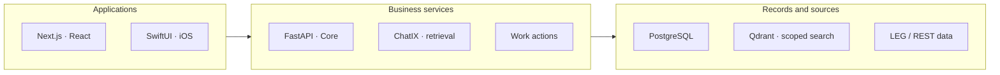
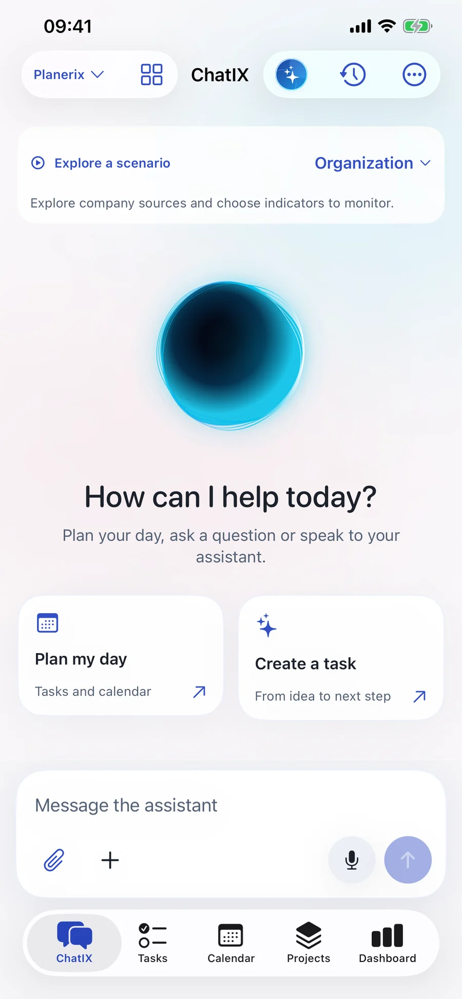

# Planerix

**Multi-Product SaaS Architecture**

Make team execution measurable.

[Portfolio index](../README.md) · [All case studies](README.md)

## Problem

Tasks and reports lose value when they live in separate systems.

## Engineering challenge

Connect people, projects, tasks and business metrics in a shared work model, while keeping source freshness, responsibility and approval boundaries visible.

## Architecture

Web and native iOS share the work model. PostgreSQL owns the records; search indexes provide candidates for source revalidation.

## Implementation

Designed a shared web and iOS workspace for projects, dependencies, KPI/OKR context and ChatIX. Agents prepare evidence-linked actions for review.

- **Coordinate the team.** Owners, assignees, comments, deadlines and dependencies connect tasks to projects and key results across web and iOS.
- **Monitor progress.** KPI-linked work shows values, targets and period context. Selected views poll every minute; upstream source cadence determines data freshness.
- **Prepare operating reviews.** Daily, weekly and monthly analysis brings work status and available metric evidence together for management review.
- **Turn analysis into action.** ChatIX and agents surface risks, recommend follow-up and prepare task or event changes. People review proposals before execution.

### Engineering decisions

- Access is checked again against the current source record after retrieval; an old vector is not permission to read.
- Task and event proposals are prepared, reviewed and confirmed. Version checks and stable operation IDs protect retries and concurrent edits.
- Source-backed metrics and bounded entity/event graphs feed the same question context; historical memory is revalidated.

### Stack

| Technology | Responsibility |
|---|---|
| FastAPI | Scoped application APIs |
| PostgreSQL | Canonical work records |
| Next.js | Web workspaces |
| SwiftUI | Native iOS experience |
| Qdrant | Permission-aware retrieval |
| Docker | Service deployment |

Connected systems: Planerix LEG — company and document context; Planerix REST — restaurant source context.

## Evidence

Native build 18 demonstration screens; mobile release contracts 26–27; the 16 October 2026 core-evidence release documents source revalidation, graph limits and worker recovery. Screens use synthetic records.

Planerix native iOS: ChatIX. Build 18 demonstration data; reviewed actions were added in later builds.

## Outcome and ownership

A web and native iOS execution workspace connects team tasks, KPI/OKR context, ChatIX and reviewed AI actions. Connected-source cadence governs metric freshness.

**My role:** Founder & product architect.

- **Architecture ownership:** Founder and product architect: business model, system design, web/native work model and product boundaries.
- **Product development:** Canonical work records, source-aware assistance and reviewed task/event changes across the shared work model.
- **Product leadership:** Product scope and integration decisions across the ecosystem.

### Delivery notes

The case demonstrates architecture and delivered workflows. It does not claim a measured productivity uplift or a complete independent security audit. iOS distribution is arranged separately.

### Links

- [Project case](https://proleev.com/en/products/planerix)
- [Public product](https://planerix.com/en)

[Verification notes](../engineering/evidence.md)
