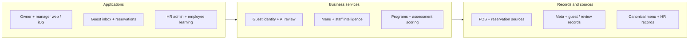
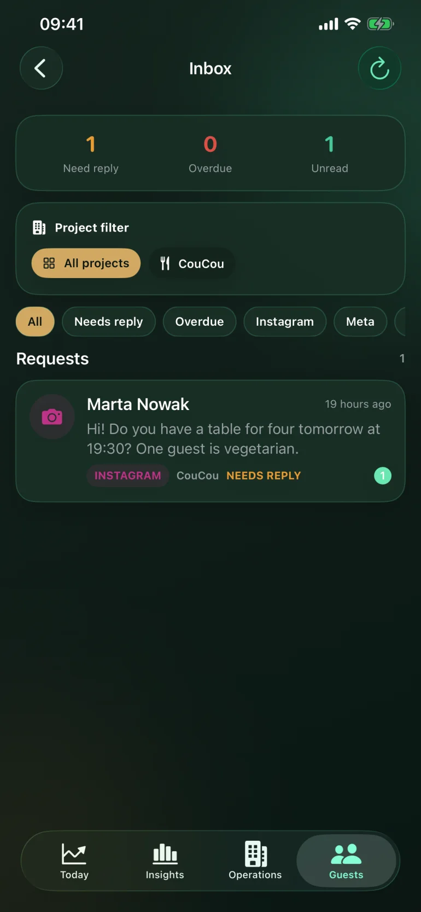

# Planerix REST

**Restaurant Operations, Guest CRM & Staff Development**

Put guest context beside restaurant performance.

[Portfolio index](../README.md) · [All case studies](README.md)

## Problem

A guest conversation rarely arrives with booking, visit and operational context attached.

## Engineering challenge

Connect restaurant communications, Guest 360, menu and staff analytics, and employee learning under consistent brand/location access and source semantics.

## Architecture

A simplified view of the implemented system; deployment and provider activation vary by product.

## Implementation

Built communications and Guest 360 alongside electronic menus, menu and staff analytics, influencer work and HR learning.

- **Handle the guest journey.** Bring booking context, reviews, Instagram Direct, comments, mentions and influencer work beside Guest 360 records and conversation history.
- **Prepare the weekly review.** Compare available mentions, tags, comments and incoming messages with organic audience trends and revenue for the same period.
- **Understand menu and team.** Electronic menu, item performance and staff analytics support operational review. HR programs, learning and assessments support team development.
- **Act from the mobile workspace.** Owners and managers inspect performance and conversations in native iOS. AI summarizes context and drafts responses for staff review.

### Engineering decisions

- Brand and location permissions are applied before building the event graph. Aggregate access does not automatically grant guest access.
- Periods, currencies and source coverage accompany metrics. Missing data stays unknown, and a live connector is not proof of complete sales data.
- Instagram Direct, comments and mentions retain source context in the inbox and Guest 360. AI manager assist analyzes intent and prepares reply suggestions; staff review and provider readiness govern sending.

### Technology and its purpose

| Technology | Responsibility |
|---|---|
| FastAPI | Restaurant APIs and permissions |
| PostgreSQL | Canonical operational records |
| Next.js | Owner and manager web |
| SwiftUI | Native owner experience |

Connected systems: iiko / Syrve — restaurant operating source; ChoiceQR — reservation / guest context; Instagram / Meta — direct, comments and mentions; OpenRouter — ai manager assistance.

## Evidence

Native owner analytics, inbox, Instagram thread and Guest 360 screens use synthetic records. Connector, manager-assist and outbox contracts explain the path from intake to a reviewed reply.

REST native communications interface. Synthetic guest data.

## Outcome and ownership

A restaurant workspace connects guest communications, reservations, influencer CRM, electronic menu, operational analytics and an HR learning surface. Available data and integrations depend on the configured location.

**My role:** Founder & product architect.

- **Architecture ownership:** Founder and product architect: business model, system design, web/native work model and product boundaries.
- **Product development:** Connect restaurant performance, social conversations and Guest 360 context while preserving brand/location access and human control over replies.
- **Product leadership:** Product scope and integration decisions across the ecosystem.

### Scope and boundaries

The delivered platform supports client-branded configurations. Each rollout has its own source coverage, permissions and support scope; no conversion uplift is claimed.

### Explore

- [Project case](https://proleev.com/en/products/rest)
- [Public product](https://rest.planerix.com)

[Selected verification and evidence policy](../engineering/evidence.md)
