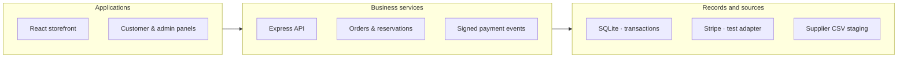

# SEOULAB

**Full-Stack E-commerce**

Build the store and the operating tools behind it.

[Portfolio index](../README.md) · [All case studies](README.md)

## Problem

A branded shopping experience also needs reliable pricing, stock and order administration.

## Engineering challenge

Build a complete skincare store: product discovery, customer accounts, reliable orders and an operational back office.

## Architecture

Storefront and administration use the commerce API for catalogue, order and stock operations.

## Implementation

Delivered the storefront, commerce backend, administration and deployment. Public catalogue is live; commerce runs in protected preview.

- **Brand and discovery.** A Polish storefront with product pages, filters, routines, quiz, editorial content and local favorites.
- **Customer accounts.** Account, address and order-history flows are implemented in the protected preview.
- **Order correctness.** The server calculates totals in integer currency units, reserves inventory and handles duplicate requests.
- **Payment handling.** The test Stripe adapter and signed webhooks check the payment amount, currency and repeated events.

### Engineering decisions

- Server-calculated totals, integer currency amounts and inventory reservations protect orders against price manipulation and overselling.
- Idempotent order creation, transactional rollback and signed Stripe webhooks handle retries and payment-state changes. The payment flow was tested in the preview environment.
- The admin panel supports catalogue work, orders and validated supplier CSV drafts. Public catalogue mode is separated from checkout and account writes.

### Stack

| Technology | Responsibility |
|---|---|
| React | Storefront and operations UI |
| TypeScript | Typed frontend implementation |
| Vite | Frontend build pipeline |
| Express | Commerce API |
| SQLite | Transactional application data |
| Docker | Application deployment |

Connected systems: Stripe — test checkout and signed webhooks.

## Evidence

Actual desktop/mobile storefront and protected admin-preview captures; documented order, stock and payment verification. The mobile store is responsive web, not a native app.

Public SEOULAB storefront. Commerce and administration remain in protected preview.

## Outcome and ownership

Delivered a branded storefront and full commerce application. The public release runs in catalogue mode; checkout, accounts and payment scenarios are available in a protected preview.

**My role:** Full-stack developer.

- **Personally designed:** End-to-end store structure, branded customer experience and administration workflow.
- **Personally implemented:** Frontend, commerce backend, admin functions and deployment.
- **Release responsibility:** Public catalogue release and protected commerce preview; payment/account capabilities are described by their actual release mode.

### Delivery notes

Personal scope is end-to-end store development and deployment. Public catalogue mode is live; public checkout, live payment acceptance and commercial uplift are not asserted.

### Links

- [Project case](https://proleev.com/en/case-studies/seoulab)
- [Public catalogue](https://seoulab.pl)

[Verification notes](../engineering/evidence.md)
