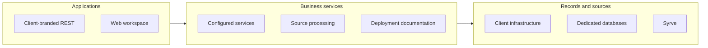

# URBAN

**White-Label Deployment & Handover**

Put the platform into the client environment.

[Portfolio index](../README.md) · [All case studies](README.md)

## Problem

A white-label product needs clear application, data and operating boundaries.

## Engineering challenge

Deliver a restaurant system that the client can operate in its own environment under its own brand.

## Architecture

The client deployment reuses the REST product model with its own branding and configured location context.

## Implementation

Delivered a client-branded REST configuration with dedicated services, databases, agreed Syrve sources and operational handover.

- **Client-branded application.** Configure REST under the client identity as a distinct delivered experience.
- **Infrastructure.** Set up services in the client environment with the deployment configuration required for operation.
- **Dedicated databases.** Separate database configuration supports the delivered client environment.
- **Syrve configuration.** Connect the agreed restaurant source to the configured operating workspace.

### Engineering decisions

- The delivery includes a client-branded REST application, dedicated databases and service configuration on the client’s infrastructure.
- Syrve configuration and project/location filters accompany operational documentation. Licence and support scope remain defined in the agreement.

### Stack

| Technology | Responsibility |
|---|---|
| Planerix REST | Client-branded application |

Connected systems: Syrve — configured restaurant data source.

## Evidence

The diagram explains the client-branded REST delivery, dedicated database/service configuration and Syrve setup. Deployment and handover documentation remain private under NDA.

## Outcome and ownership

A client-branded REST deployment with dedicated infrastructure, Syrve configuration and project/location filters.

**My role:** Systems delivery & handover.

- **System delivery:** Client-branded REST configuration, infrastructure and operational handover.
- **Implementation:** Dedicated application services, database configuration and agreed Syrve source filters.
- **Handover:** Deployment configuration and documentation for client operation under the agreed licence and support scope.

### Delivery notes

The contribution is client configuration, infrastructure delivery and handover of REST. Product reuse is explicit; uptime commitments and intellectual-property terms are not inferred from this case.

Some internal data and implementation details are protected by NDA. Public examples identify demonstration or prototype interfaces.

### Links

- [Project case](https://proleev.com/en/case-studies/urban)

[Verification notes](../engineering/evidence.md)
