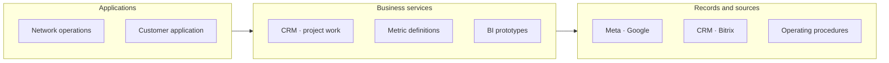
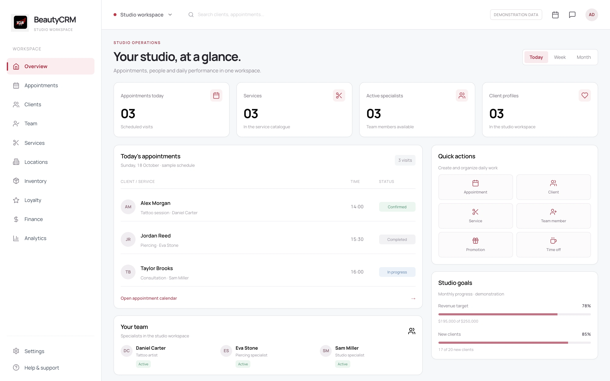

# VEAN

**Operations, Automation & BI**

Design an operating model that works across locations.

[Portfolio index](../README.md) · [All case studies](README.md)

## Problem

A growing international network needs common measures, responsibilities and execution routines.

## Engineering challenge

Coordinate a service network through repeatable processes and comparable marketing and operating information.

## Architecture

A view of the operating model and supporting systems. The separate BeautyCRM prototype is identified below.

## Implementation

Led KPI/OKR governance, reporting, process standards, unit economics and ERP/CRM/BI initiatives across departments.

- **Operating model.** Procedures and repeatable processes support consistent work across a service network.
- **CRM and coordination.** CRM, Bitrix and project work connect responsibilities and commercial activity.
- **Marketing automation.** Source collection from Meta, Google and CRM supports coordinated marketing operations.
- **Metric definitions.** Common definitions make indicators more comparable across operating and marketing contexts.

### Engineering decisions

- CRM, project work and procedures support responsibilities and coordinated marketing operations.
- Source collection from Meta, Google, CRM and Bitrix supports common metric definitions and BI prototypes. Customer-tool initiatives formed part of the wider systems work.

### Stack

| Technology | Responsibility |
|---|---|
| Next.js | Local CRM prototype frontend |
| React | Local CRM interface components |
| TypeScript | CRM prototype application code |

Connected systems: Meta — marketing source collection; Google — marketing source collection; CRM / Bitrix — customer and operating records.

## Evidence

The case combines operating leadership, management frameworks and supporting CRM/BI work. The public interface example is a related BeautyCRM prototype; internal operating and customer records remain protected by NDA.

BeautyCRM prototype with demonstration data. This is not a historical VEAN production screenshot.

## Outcome and ownership

Operations, CRM, marketing automation, metric definitions and BI prototypes, alongside customer application development.

**My role:** COO / 16-country remit / 100+ employees.

- **Personally designed:** KPI/OKR governance, management reporting, process standards and performance models across the organization.
- **Led systems initiatives:** ERP/CRM/BI foundations, automation, customer/internal tools, marketing and sales analytics.
- **Led & coordinated:** COO responsibility across marketing, sales, operations and finance; network remit of 16 countries and 100+ employees.

### Delivery notes

The role combines operating leadership and technical delivery coordination. Prototype reporting is not presented as a fully accepted production BI estate; measured ROI is not published.

Some internal data and implementation details are protected by NDA. Public examples identify demonstration or prototype interfaces.

### Links

- [Project case](https://proleev.com/en/case-studies/vean)

[Verification notes](../engineering/evidence.md)
