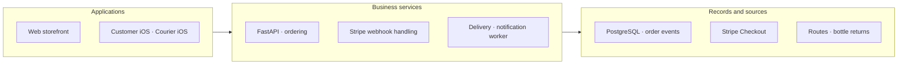
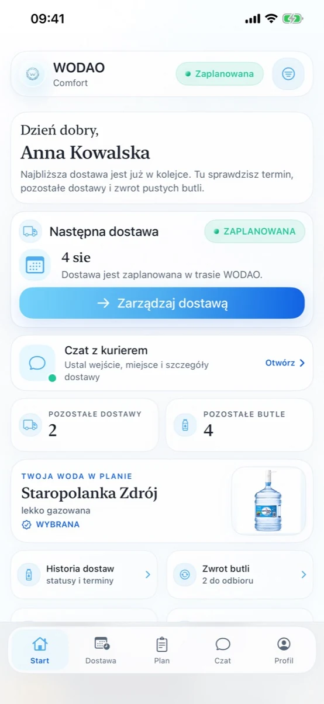

# WODAO

**Commerce, Subscriptions & Delivery**

Take a recurring service from payment to delivery.

[Portfolio index](../README.md) · [All case studies](README.md)

## Problem

Subscriptions need to stay consistent with payment events and physical fulfilment.

## Engineering challenge

Keep subscriptions, payment events, orders and physical delivery in agreement when providers retry or an operation needs follow-up.

## Architecture

A simplified view of the implemented system; deployment and provider activation vary by product.

## Implementation

Connected storefront, customer and courier apps with subscriptions, payments, delivery workflows and reusable-bottle handling.

- **Manage recurring service.** Plans, subscription periods, customer orders and delivery choices represent an ongoing service relationship across web and native apps.
- **Confirm payment safely.** Signed Stripe events reconcile checkout and payment state. A return to the website alone cannot mark an order as paid.
- **Coordinate field work.** Courier routes and shifts connect delivery stops, proof, rescheduling and reusable-bottle collection to operational records.
- **Keep follow-up independent.** Workers and outbox records handle background notifications separately from payment and order processing, preserving inspectable delivery state.

### Engineering decisions

- Stripe callbacks verify the signed payload before payment events reach order processing. Blocking provider and database calls run off the API event loop.
- Orders, order events and subscription periods are explicit data structures. Customer and courier journeys share the operational record.
- A worker dispatches notification events and outbox records. Delivery status and exceptions remain part of the service workflow.

### Technology and its purpose

| Technology | Responsibility |
|---|---|
| FastAPI | Commerce and delivery APIs |
| PostgreSQL | Orders and operational events |
| SwiftUI | Customer and courier apps |
| Docker | Service deployment |

Connected systems: Stripe — checkout and subscription events.

## Evidence

Customer and courier interfaces, the signed-webhook route, checkout-completion lock, order/subscription schema and worker/outbox source support the case. Implementation was reviewed; no new live payment was made for this portfolio.

WODAO customer interface. Demonstration customer and order data.

## Outcome and ownership

A digital operating system for an independent delivery business: commerce, recurring service, customer and courier work. This case describes the delivered workflow, not a claimed revenue uplift.

**My role:** Founder & product owner.

- **Product ownership:** Founder and product owner: recurring commerce, customer experience and delivery operations.
- **Delivered components:** Customer and courier applications, subscription/payment flows, delivery workflows and the supporting data/integration layer.
- **Operational responsibility:** Product requirements, release priorities and the relationship between software and the operating delivery business.

### Scope and boundaries

Ownership covers product direction, commerce and operating workflows. Provider services remain external dependencies. Revenue uplift, delivery SLA and universal event deduplication are not claimed.

### Explore

- [Project case](https://proleev.com/en/products/wodao)
- [Public business](https://wodao.pl)

[Selected verification and evidence policy](../engineering/evidence.md)
