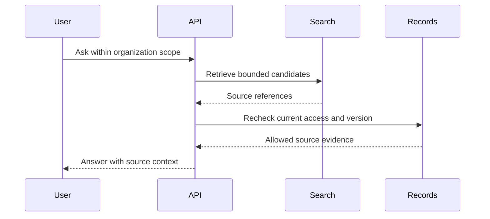
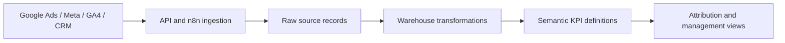

# Three engineering decisions

## 1. Revalidate retrieved context

**Reference: Planerix.** Search can find an old reference to a task or document. That does not mean the user may still read the current record.

PostgreSQL remains authoritative; the index helps locate context. This adds a source lookup, but allows permissions, deletions and versions to govern the answer. Entity relationships help rank and explain context; they do not establish causality. [Planerix case](../cases/planerix.md).

## 2. Keep a payment callback from completing checkout twice

**Reference: WODAO checkout completion.** A provider callback can arrive again while the first operation is still running.

The handler verifies the signature, obtains a provider-session advisory lock, reloads checkout state and checks whether completion already happened. The dedicated connection retains lock ownership across ORM commits. Notification delivery runs separately through workers and outbox records.

The scope is the described checkout-completion path, not a claim of exactly-once execution across all services. Local tests cover lock lifecycle and late events with database/provider doubles; a live PostgreSQL concurrency test is a separate check. [WODAO case](../cases/wodao.md).

## 3. Separate collection from interpretation

**Reference: IT STEP.** Advertising and CRM systems describe different events and may update at different times.

Separate layers make the reporting definition inspectable without overwriting the source. Reporting periods, identities and source cadence remain part of the model. The public case uses diagrams derived from archived workflow/SQL exports; it does not publish client rows, credentials or unmeasured throughput. [IT STEP case](../cases/itstep.md).
