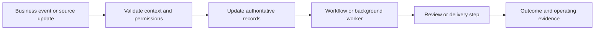

# Integration and delivery work

The same integration problems recur across products. Here is where the approaches were used and what the implementation had to handle.

| Practice | What the implementation addresses | Reference work |
|---|---|---|
| n8n automation | Template contracts, credential binding, provisioning and runtime inspection | Planerix, IT STEP |
| DevOps and monorepos | Shared dependencies, service boundaries, container builds, migrations and release/recovery procedures | Planerix, WODAO, the portfolio websites |
| Database engineering | Transactional records, constraints, warehouse layers and separation of canonical facts from retrieval | WODAO, IT STEP, Planerix, SEOULAB |
| Telegram bots | Event routing, intended audience, notification state and source-based briefings | WODAO, Planerix, Ninja Group |
| AI agents and graphs | Scoped candidates, current source permissions, bounded relationships and reviewed actions | Planerix ChatIX, LEG, REST |
| Instagram CRM | Direct messages, comments and mentions connected to guest context and staff-reviewed replies | REST |

## From an event to accountable work

The pattern varies by domain. A notification worker does not own payment truth; an AI retrieval index does not own access rights; a source connection alone does not guarantee complete analytics.

## How this translates into an engagement

- Model a shared data and API foundation for a SaaS or internal platform.
- Connect a commerce journey to billing, subscriptions and fulfilment.
- Build a reporting pipeline with agreed KPI definitions and source lineage.
- Add source-based assistance with explicit permissions and review boundaries.
- Prepare release and operating procedures for an existing product.

Scope, ownership and validation are agreed for the particular system. See the [case studies](../cases/README.md) for work already delivered.

## Runnable examples

The public examples isolate four of these problems:

- [Webhook delivery](https://github.com/aistrategyc/reliable-webhook-lab): transaction boundaries and background recovery.
- [Tenant access](https://github.com/aistrategyc/tenant-access-lab): current permissions and record scope.
- [Analytics](https://github.com/aistrategyc/analytics-pipeline-lab): the data contract between source adapters, ETL and reporting.
- [RAG](https://github.com/aistrategyc/source-aware-rag-lab): source access and reviewed changes.

Each has a locked environment, PostgreSQL tests, CI and operating notes. The analytics and RAG notes also describe where an n8n adapter would connect. They do not include a live n8n connector or a production deployment.
